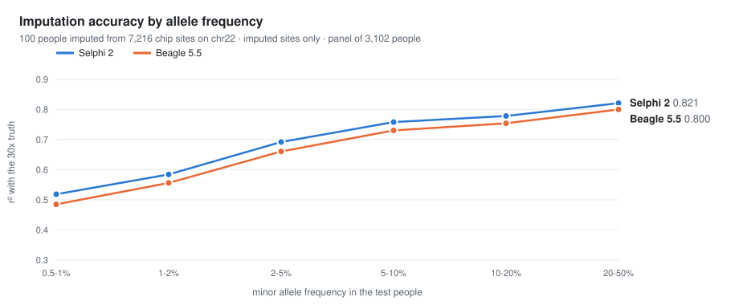
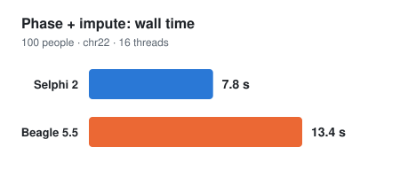
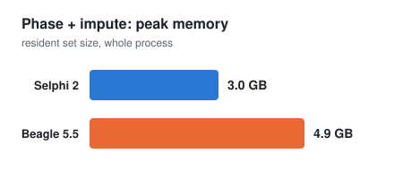
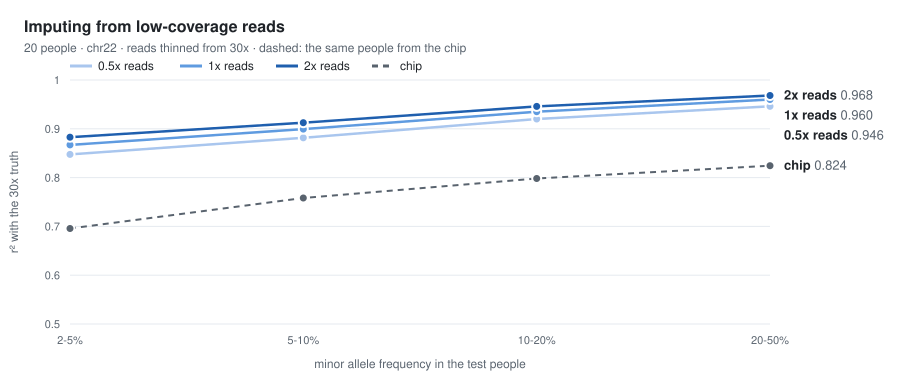

<picture>
  <source media="(prefers-color-scheme: dark)" srcset="img/hero_dark.svg">
  
</picture>

A genotyping chip reads a few hundred thousand sites of your genome. Imputation fills in the other millions by
finding, stretch by stretch, the people in a reference panel whose DNA matches yours, and copying from them.
[Selphi 2](https://github.com/omicsedge/selphi2) does this in Rust: phasing and imputation in one run, from a chip,
a whole genome or low-coverage reads.

This tutorial runs it end to end on public data: chromosome 22 of 100 people from the 1000 Genomes Project,
imputed from a simulated chip and scored against their 30x genomes. Then the same job with Beagle 5.5 to compare,
and finally imputation straight from 1x sequencing reads.

<picture>
  <source media="(prefers-color-scheme: dark)" srcset="img/flow_dark.svg">
  
</picture>

On this data Selphi 2 is more accurate than Beagle 5.5 at every allele frequency, 1.7 times as fast
(7.8 s against 13.4 s for 100 people) and uses 40% less memory. [Step 4](#step-4-compare-with-beagle) has the numbers.

<picture>
  <source media="(prefers-color-scheme: dark)" srcset="img/r2_dark.svg">
  
</picture>

## Contents

- [How imputation works](#how-imputation-works)
- [Install](#install)
- [Step 1. Download the data](#step-1-download-the-data)
- [Step 2. Prepare the panel, the test people and their chip](#step-2-prepare-the-panel-the-test-people-and-their-chip)
- [Step 3. Impute with Selphi 2](#step-3-impute-with-selphi-2) and [read the output](#reading-the-output)
- [Step 4. Compare with Beagle](#step-4-compare-with-beagle)
- [Step 5. Impute from 1x reads](#step-5-impute-from-1x-reads)
- [Coming from Beagle](#coming-from-beagle)
- [Your own data](#your-own-data)

Every command below was run as written, on a 16-thread Linux machine; the numbers and logs you see come from
that run. The scripts in [`scripts/`](scripts) do the same thing in one go.

## How imputation works

Your two copies of chromosome 22 (haplotypes) are mosaics of pieces you share with other people, because we all
descend from a limited set of ancestors. Selphi 2 first **phases** your chip genotypes (works out which allele
sits on which copy), then, for each copy, finds which panel haplotypes it matches along the chromosome (a
Li-Stephens copying model over the panel), and **imputes** every site the chip did not read by weighting the
alleles of those haplotypes.

<picture>
  <source media="(prefers-color-scheme: dark)" srcset="https://raw.githubusercontent.com/omicsedge/selphi2/main/img/how_dark.svg">
  
</picture>

## Install

You need bcftools (1.15 or later), samtools for step 5, and Selphi 2. Selphi 2 builds with Rust 1.89 or later and a
C compiler, on Linux and macOS, x86_64 (AVX2 + FMA) and aarch64 (Apple Silicon, AWS Graviton):

```bash
conda create -n selphi -c conda-forge -c bioconda bcftools samtools rust
conda activate selphi

git clone https://github.com/omicsedge/selphi2.git
cd selphi2 && cargo build --release && cd ..
export PATH=$PWD/selphi2/target/release:$PATH
selphi --help | head -3
```

On Linux you can skip the build: download `selphi-linux-x86_64` or `selphi-linux-aarch64` (or the static
`-musl` build) from the [current release](https://github.com/omicsedge/selphi2/releases/tag/2.0.0-rc7),
rename it to `selphi` and `chmod +x` it.

Then get this tutorial:

```bash
git clone https://github.com/adrianodemarino/Imputation_selphi2_tutorial.git
cd Imputation_selphi2_tutorial
```

## Step 1. Download the data

```bash
scripts/01_download.sh
```

- the **1000 Genomes high-coverage panel** for chromosome 22: 3,202 people sequenced at 30x by the New York Genome
  Center and phased, on GRCh38 (425 MB);
- the sample sheet (sex, population, family);
- the **genetic map** (Beagle's PLINK-format GRCh38 maps, which Selphi reads as they are). The file for
  chromosome 22 is `maps/chr_in_chrom_field/plink.chrchr22.GRCh38.map`: the double `chr` is in the file name only.

## Step 2. Prepare the panel, the test people and their chip

To measure accuracy we need people whose whole chromosome we know but whom the panel has never seen. We take 100
of them out (20 per continental group, none with a parent or child in 1000 Genomes; the list is
[`test_samples.txt`](test_samples.txt)), keep their 30x genotypes as the truth, and give the imputation only what
a chip would read: common SNPs, one every 5 kb or so, unphased.

```bash
scripts/02_prepare.sh
```

```text
panel    3102 people    1064451 sites
truth     100 people    1065095 sites
array     100 people       7216 sites
```

The key lines of [`02_prepare.sh`](scripts/02_prepare.sh):

```bash
IN=data/1kGP_high_coverage_Illumina.chr22.filtered.SNV_INDEL_SV_phased_panel.vcf.gz

# Panel: everyone except the 100, biallelic SNPs and indels, still polymorphic without them
bcftools view -S ^test_samples.txt -v snps,indels -m2 -M2 "$IN" -Ou | bcftools view -c1 -Oz -o work/panel.chr22.vcf.gz
bcftools index -f -t work/panel.chr22.vcf.gz

# Chip: common SNPs (MAF >= 1%), at most one every 5 kb, genotypes unphased
bcftools view -v snps -q 0.01:minor work/panel.chr22.vcf.gz -Ou | bcftools query -f '%CHROM\t%POS\n' |
  awk 'BEGIN{OFS="\t"} $2 >= last + 5000 {print; last = $2}' > work/array_sites.chr22.tsv
bcftools view -T work/array_sites.chr22.tsv work/truth.chr22.vcf.gz -Ou |
  bcftools +setGT -Ou - -- -t a -n u | bcftools annotate -x INFO -Oz -o work/array.chr22.vcf.gz
bcftools index -f -t work/array.chr22.vcf.gz
```

## Step 3. Impute with Selphi 2

Three commands: convert the panel once, impute, score.

```bash
MAP=maps/chr_in_chrom_field/plink.chrchr22.GRCh38.map
mkdir -p results

# 3a. Panel -> .srp2, Selphi's own format (VCF.gz, BCF and BREF3 all work as input). Once per panel.
selphi --prepare-reference-from work/panel.chr22.vcf.gz --out work/panel.chr22.srp2 --threads 16

# 3b. Phase + impute
selphi --refpanel work/panel.chr22.srp2 --input work/array.chr22.vcf.gz --map $MAP \
  --out results/selphi2.chr22 --threads 16

# 3c. Score against the 30x truth, on the imputed sites only
selphi --evaluate results/selphi2.chr22.vcf.gz --truth work/truth.chr22.vcf.gz \
  --exclude-sites work/array.chr22.vcf.gz --out results/selphi2.eval
```

This is what you will see (the real run, replayed with the pauses shortened):

<picture>
  <source media="(prefers-color-scheme: dark)" srcset="img/run_array_dark.svg">
  
</picture>

The `emission error rate` note near the end is expected: the last window of chr22 is short, almost every
panel haplotype matches its few chip sites, so Selphi uses the default error rate there (`--p-err`, 0.025).
There is nothing to do about it.

What happened:

- **3a** read the 445 MB panel VCF and wrote an 82 MB `.srp2` (the bref3 of the same panel is 196 MB). It took
  48 seconds and 12.7 GB of memory, once; every run after it opens the panel in a fraction of a second.
- **3b** phased the 100 people (the chip calls are unphased), then imputed all 1,064,451 panel sites in
  **7.8 seconds** with 3.0 GB of memory. The last line is Selphi's own estimate of the quality, before any truth is
  used.
- **3c** compared the imputed dosages with the 30x genotypes on the 1,057,215 sites that were not on the chip:

```text
MAF bin                N variants    Mean R²  Concordance
------------------------------------------------------------
0.5-1%                     133440     0.5185       0.9931
1-2%                        75037     0.5843       0.9872
2-5%                        59848     0.6918       0.9778
5-10%                       33375     0.7578       0.9592
10-20%                      32447     0.7783       0.9295
20-50%                      59375     0.8209       0.9002

Per-sample (n=100):
  R²:          mean=0.907131, min=0.863519, max=0.942620
```

r² by frequency bin is the squared correlation, over all sites in the bin, between imputed dosage and true
genotype; it is the standard way to compare imputation tools. Concordance (the share of exactly right genotypes)
looks high for rare variants only because most people carry none. The per-sample r² is computed across all sites
of one person: on average 0.91.

The bins start at 0.5% because with 100 people (200 copies of chr22) the rarest allele we can see is 1 in 200.

### Reading the output

```bash
# one imputed site and one chip site, first person only
bcftools view -H -i 'INFO/IMP=1 && INFO/AF>0.2' results/selphi2.chr22.vcf.gz | head -1 | cut -f1-10
bcftools view -H -e 'INFO/IMP=1' results/selphi2.chr22.vcf.gz | head -1 | cut -f1-10
```

```text
chr22  10562806  22:10562806:C:T  C  T  .  PASS  AF=0.245;AC=49;AN=200;DR2=0.767;IMP   GT:DS:AP1:AP2  0|1:0.824:0.01:0.82
chr22  10519276  22:10519276:G:C  G  C  .  PASS  AF=0.025;AC=5;AN=200                   GT             0|0
```

| Field | Meaning |
|---|---|
| `GT` | phased genotype: `0\|1` means ALT on the second copy only |
| `DS` | dosage: expected number of ALT alleles, 0 to 2 |
| `AP1`, `AP2` | probability of ALT on copy 1 and on copy 2 |
| `INFO/AF` | ALT frequency in the imputed people |
| `INFO/DR2` | estimated r² between dosage and true genotype; filter with `-i 'INFO/DR2>=0.3'` |
| `INFO/IMP` | the site was imputed (not on the chip) |

Other formats: `--bcf`, `--parquet`, `--pgen` (PLINK 2), several at once.

## Step 4. Compare with Beagle

```bash
scripts/04_beagle.sh      # downloads Beagle 5.5, converts the panel to bref3, imputes, scores the same way
```

Same people, same chip, same panel, same map, same scoring:

<picture>
  <source media="(prefers-color-scheme: dark)" srcset="img/r2_dark.svg">
  
</picture>

<p>
<picture>
  <source media="(prefers-color-scheme: dark)" srcset="img/time_dark.svg">
  
</picture>
<picture>
  <source media="(prefers-color-scheme: dark)" srcset="img/memory_dark.svg">
  
</picture>
</p>

| | Selphi 2 | Beagle 5.5 |
|---|---|---|
| r², MAF 0.5-1% | **0.519** | 0.485 |
| r², MAF 1-2% | **0.584** | 0.556 |
| r², MAF 2-5% | **0.692** | 0.660 |
| r², MAF 5-10% | **0.758** | 0.730 |
| r², MAF 10-20% | **0.778** | 0.754 |
| r², MAF 20-50% | **0.821** | 0.800 |
| r² per person (mean) | **0.907** | 0.893 |
| phase + impute, wall time | **7.8 s** | 13.4 s |
| peak memory | **3.0 GB** | 4.9 GB |
| panel file | **82 MB** `.srp2` | 196 MB `.bref3` |

Times and memory are for the phase + impute command alone, 16 threads, panel already converted, measured with
`/usr/bin/time`, median of three runs. Beagle's memory is the whole Java process, run with `-Xmx16g`. One chromosome and 100 people is a small job; on larger cohorts and the whole genome the gap in
time and memory grows (see the [Selphi 2 README](https://github.com/omicsedge/selphi2#performance)).

## Step 5. Impute from 1x reads

Low-coverage sequencing (0.5x to 2x) reads the whole genome a little instead of a few sites well. Selphi 2
imputes straight from the aligned reads, no variant calling first. Here 20 of the test people (4 per
continental group, [`lowcov_samples.txt`](lowcov_samples.txt)) have their 30x chr22 reads thinned to 1x:

```bash
scripts/05_lowcov.sh          # COV=0.5 or COV=2 for other depths
```

It downloads the reference genome the CRAMs were aligned to (3.1 GB, once), streams each person's chr22 reads
from the 1000 Genomes CRAM (about 1 GB each), keeps 1/30 of the read pairs with `samtools view -s`, then runs

```bash
selphi --bam-list reads/crams_1x.txt --reference ref/GRCh38_full_analysis_set_plus_decoy_hla.fa \
  --refpanel work/panel.chr22.srp2 --map $MAP --out results/lowcov_1x.chr22 --threads 16
```

If samtools stops with `Problem with the SSL CA cert`, point it at your system certificates first:
`export CURL_CA_BUNDLE=/etc/ssl/certs/ca-certificates.crt`.

<picture>
  <source media="(prefers-color-scheme: dark)" srcset="img/run_lowcov_dark.svg">
  
</picture>

The 20 people imputed from 1x reads took about 4 minutes (about 12 seconds per person) and 9.7 GB of memory. Then
the same scoring, on every site:

<picture>
  <source media="(prefers-color-scheme: dark)" srcset="img/lowcov_dark.svg">
  
</picture>

| | chip (7,216 sites) | 0.5x reads | 1x reads | 2x reads |
|---|---|---|---|---|
| r², MAF 2-5% | 0.696 | 0.848 | 0.867 | 0.883 |
| r², MAF 20-50% | 0.824 | 0.946 | 0.960 | 0.968 |
| r² per person (mean) | 0.906 | 0.963 | 0.969 | 0.973 |
| phase + impute | 7.8 s (all 100 people) | 202 s | 229 s | 250 s |

Even half a read per site beats the chip by a wide margin, because the reads touch almost every common variant
instead of one every 5 kb. The bins start at 2% here because 20 people carry 40 copies of chr22.

These reads are 30x NovaSeq reads thinned at random, which is close to, but cleaner than, a real low-coverage
library.

## Coming from Beagle

| Beagle 5.5 | Selphi 2 |
|---|---|
| `java -jar bref3.jar panel.vcf.gz > panel.bref3` | `selphi --prepare-reference-from panel.vcf.gz` (also reads `.bref3`) |
| `gt=target.vcf.gz` | `--input target.vcf.gz` |
| `ref=panel.bref3` | `--refpanel panel.srp2` |
| `map=chr22.map` | `--map chr22.map` (or `--map-dir maps/` for all chromosomes) |
| `out=prefix` | `--out prefix` |
| `nthreads=16` | `--threads 16` |
| `impute=false` | `--phase-only` |
| `gp=true` | `--gp` |
| `ap=true` | on by default (`AP1`, `AP2`; `--no-ap` to drop) |
| one run per chromosome | `--map-dir` with a multi-chromosome `.srp2` runs the whole genome |
| no low-coverage mode | `--bam`, `--bam-list` |

## Your own data

- **Same build and chromosome names** in target, panel and map (`chr22` vs `22`): rename with
  `bcftools annotate --rename-chrs`. Data lifted over from GRCh37 needs a careful check.
- **Strand and alleles.** Selphi matches each chip site to the panel by position and alleles, and accepts a
  swapped REF/ALT (not for palindromic A/T and C/G SNPs). For a chip on the other strand add `--allele-match full`.
- **chrX** works as is: men are recognised from their genotypes. Put the `_par1` and `_par2` maps next to the
  chrX map and they are joined automatically.
- **Sample QC first**: drop samples and sites with many missing calls, and sites far from Hardy-Weinberg.
- **The panel matters more than the tool.** The larger it is and the closer to your people, the better rare
  variants come out.
- `selphi --help` lists every option; the [Selphi 2 README](https://github.com/omicsedge/selphi2#usage) explains
  them.

## Citation and license

```text
Selphi, a tool for improving genotype imputation accuracy
Adriano De Marino, Abdallah Amr Mahmoud, Sandra Bohn, Jon Lerga-Jaso, Biljana Novković,
Charlie Manson, Salvatore Loguercio, Andrew Terpolovsky, Mykyta Matushyn, Ali Torkamani, Puya G. Yazdi
Scientific Reports 16, 28051 (2026); doi: https://doi.org/10.1038/s41598-026-58420-2
```

Selphi 2 is free for academic research. Commercial use needs a license: see
[its LICENSE](https://github.com/omicsedge/selphi2/blob/main/LICENSE).

Data: Byrska-Bishop M et al. High-coverage whole-genome sequencing of the expanded 1000 Genomes Project cohort
including 602 trios. *Cell* 2022;185:3426-3440.
